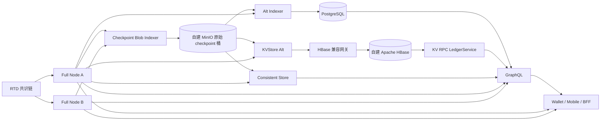

# 01 · 决策总览与源码映射

## 1. 回答“官方是否有标准实现”

有。Sui 官方分别发布了[通用索引器与 GraphQL 生产指南](https://docs.sui.io/operators/data-management/indexer-stack-setup)、[原始 checkpoint 远程存储指南](https://docs.sui.io/operators/data-management/remote-store-setup)和[归档存储及 gRPC 服务指南](https://docs.sui.io/operators/data-management/archival-stack-setup)。RTD 当前 `temp/rtd` fork 对应的 Cargo workspace 包含这些 Rust 实现；**下面列的是业务源码职责，不是当前生产已部署服务**。RTD 测试网与未来正式网只能使用自建开源中间件：MinIO、PostgreSQL、RocksDB、Apache HBase/HDFS/ZooKeeper，以及自建开源备份、密钥、入口和监控。Bigtable 连接层已在 dev 改为自建 HBase 网关并完成 0–100 真实回填；生产 MinIO/HDFS HA 和完整恢复仍待验收。完整方案见 [03](./03-远程检查点归档存储与Ledger-gRPC.md)与[开源中间件政策](../../../rtd-archive-service/OPEN_SOURCE_POLICY.md)。

| 职责                                    | Sui 标准组件                       | `temp/rtd` 对应实现                                                                                                                                | 持久层或上游                                              | 对外能力                                                           |
| --------------------------------------- | ---------------------------------- | -------------------------------------------------------------------------------------------------------------------------------------------------- | --------------------------------------------------------- | ------------------------------------------------------------------ |
| 最新链状态、执行、模拟、checkpoint 订阅 | Full Node gRPC                     | [`rtd-node`](../../../temp/rtd/crates/rtd-node/src/lib.rs#L3155-L3245)、[`rtd-rpc-api`](../../../temp/rtd/crates/rtd-rpc-api/src/lib.rs#L220-L288) | 节点本地状态；接收链共识数据                              | Ledger/State/Execution/Subscription 等 gRPC；修剪窗口内历史        |
| 原始 checkpoint 长期源                  | `sui-checkpoint-blob-indexer`      | [`rtd-checkpoint-blob-indexer`](../../../temp/rtd/crates/rtd-checkpoint-blob-indexer/src/main.rs#L35-L100)                                         | 未修剪节点或同链完整源 → 自建 MinIO                       | `{seq}.binpb.zst`、`epochs.json`；不是业务查询接口                 |
| 条件筛选目录                            | `sui-indexer-alt`                  | [`rtd-indexer-alt`](../../../temp/rtd/crates/rtd-indexer-alt/src/main.rs)                                                                          | 原始 checkpoint 或 Full Node → PostgreSQL                 | 地址交易、事件、对象版本等筛选索引，须由 GraphQL 读取              |
| 近期一致的持有对象与余额                | `sui-indexer-alt-consistent-store` | [`rtd-indexer-alt-consistent-store`](../../../temp/rtd/crates/rtd-indexer-alt-consistent-store/src/main.rs)                                        | checkpoint → 独立 RocksDB                                 | 近期 checkpoint 上的持有对象、余额 gRPC；不是全历史归档            |
| 历史原始数据写入                        | `sui-kvstore-alt`                  | [`rtd-kvstore-alt` 可执行文件](../../../temp/rtd/crates/rtd-kvstore/src/bin/rtd-kvstore-alt.rs#L23-L67)（包名是 `rtd-kvstore`）                    | 完整 checkpoint 源 → 适配网关 → HBase 14 表               | 归档数据生产，不直接面向应用                                       |
| 历史 Ledger gRPC                        | `sui-kv-rpc`                       | [`rtd-kv-rpc`](../../../temp/rtd/crates/rtd-kv-rpc/src/main.rs#L19-L33)                                                                            | 自建 HBase（适配后）                                      | 同版 `LedgerService` 点查；按配置提供部分 `List*`，不提供执行/订阅 |
| 前端聚合查询                            | `sui-indexer-alt-graphql`          | [`rtd-indexer-alt-graphql`](../../../temp/rtd/crates/rtd-indexer-alt-graphql/src/lib.rs#L342-L373)                                                 | PostgreSQL、Consistent Store、归档 Ledger gRPC、Full Node | GraphQL 查询与可选的执行/模拟入口                                  |

官方明确 GraphQL 的四类后端职责：归档处理大量 checkpoint/对象/交易详情点查，Consistent Store 处理近期对象与余额，PostgreSQL 支持筛选，Full Node 负责执行与模拟。[官方部署说明](https://docs.sui.io/operators/data-management/indexer-stack-setup)。`rtd-kv-rpc` 只注册 Ledger/MovePackage 服务，不能把它当成 Full Node 的执行或订阅端点：[服务注册源码](../../../temp/rtd/crates/rtd-kv-rpc/src/lib.rs#L309-L342)。

## 2. 推荐的 RTD 数据面

图中同时画出原始桶和 Full Node，是为了表示**回填/故障恢复**与**追链头**两类来源，并不要求每个进程同时从两个来源消费同一序号。官方建议通用索引器先从全保留桶回填，再以已提交水位切换到 Full Node gRPC 追链头；断线超过节点修剪窗口时退回桶补洞。[官方通用索引器两阶段运行](https://docs.sui.io/operators/data-management/indexer-stack-setup)。原始桶必须属于同一 RTD 网络。Sui 官方公共测试端点、Requester Pays 桶、归档 URL、形式化快照及其链 ID **不能**映射为 RTD 可用资源。

## 3. 数据产品的责任边界

| 需求                                                 | 主入口                                                 | 为什么                                                                      | 失去该层会怎样                                                                                                |
| ---------------------------------------------------- | ------------------------------------------------------ | --------------------------------------------------------------------------- | ------------------------------------------------------------------------------------------------------------- |
| 已签名交易提交、模拟、最新状态与 checkpoint 流       | Full Node gRPC；GraphQL 的交易入口最终也依赖 Full Node | 需要当前节点状态和执行能力                                                  | 只读索引或归档不能替代执行；需降级为“无法提交/模拟”                                                           |
| 已知 digest、对象 ID+版本、checkpoint 序号的长期详情 | `rtd-kv-rpc` Ledger gRPC；前端可经 GraphQL 查询        | Full Node 有修剪下界；归档按键长期保留                                      | 旧详情不可读，即使 PG 能筛出 ID 也不能展示完整内容                                                            |
| 按地址/类型/时间过滤、分页、对象版本目录             | PostgreSQL Alt + GraphQL                               | 原始 checkpoint 无查询索引；归档 Ledger 的可选 `List*` 仅支持协议规定的过滤 | GraphQL 全历史列表需相应 PG 保留；若改由归档 List 直接提供受支持的过滤，须启用并验收 3 条附加管线及客户端路由 |
| 当前余额与持有对象的同 checkpoint 视图               | Consistent Store + GraphQL；特定点查可用 Full Node     | 最近状态须固定 checkpoint 才能跨查询一致                                    | 历史 PG 表或已修剪对象不能冒充当前余额                                                                        |
| 审计级重放、重建与另一地域独立索引                   | 验证过的原始 checkpoint 长期桶                         | 可从创世重算派生数据库                                                      | 仅有 PG/HBase 备份不能完整证明或重建原始链事实                                                                |

`rtd-kv-rpc` 的可选 `ListTransactions`、`ListEvents`、`ListCheckpoints` **确实能够做部分历史筛选**。交易过滤 proto 包含 sender、affected address/object、Move call 和事件维度；交易 List 源码使用 Bigtable bitmap 数据模型，目标由 HBase 网关保持语义。[过滤合同](../../../rtd-apis/proto/rtd/rpc/v2/filter.proto#L7-L61)、[List 索引路径](../../../temp/rtd/crates/rtd-kv-rpc/src/v2/list_transactions.rs#L156-L193)。若所需钱包活动/事件列表完全落在这些过滤能力内，可为该具体功能选择归档 List 的长期查询路径，但须显式启用 List、从 0 完整回填三个附加管线，并验证限额、分页、SDK/BFF 路由和性能。它不会自动代替标准 GraphQL→PG 的查询路径，也不支持任意 GraphQL 组合查询。

官方 [GraphQL 架构页](https://docs.sui.io/develop/accessing-data/graphql/graphql-rpc) 曾写归档不可用时回退 PostgreSQL；但此 `temp/rtd` 版本启动路径[强制 `--ledger-grpc-url`](../../../temp/rtd/crates/rtd-indexer-alt-graphql/src/lib.rs#L351-L373)。因此本版本的**启动硬依赖是一个 LedgerService URL**；短历史试验可暂指 Full Node 的 LedgerService，但面向生产承诺完整旧史时必须让该 URL 指向已验收的长期归档端点。即使未来某版本恢复 PG 回退，也不能以临时回退替代完整历史和服务等级。

## 4. 版本与决策原则

1. Full Node、原始 writer、Alt、Consistent Store、KVStore、KV RPC、GraphQL **同源于一个已锁定的 `temp/rtd` 提交**构建；另锁定 RTD API/proto 与 TS SDK 版本。当前源码存在 `rtd-indexer-alt-jsonrpc`，但这是过渡二进制，不是本方案的新生产读入口。
2. 同一链的创世 checkpoint digest、`GetServiceInfo.chain_id`、PG/归档 HBase 管线绑定的 chain ID 和所有对象桶的来源须逐一核对，不能仅比较“mainnet/devnet”标签。Alt 框架会拒绝已写管线的异链 checkpoint，[源码](../../../temp/rtd/crates/rtd-indexer-alt-framework/src/pipeline/processor.rs#L116-L134)；运维仍须先做入口级隔离。
3. 原始 checkpoint 长期保留从 **0** 开始。PG 的某些可修剪筛选管线可按明确产品窗口后起步；HBase 归档、Consistent Store 的当前状态构建及 PG 不可修剪基础管线不能跳过必要历史。具体规则见后续两份组件指南。
4. **确定保留官方 KVStore Alt 处理管线与 KV RPC 的 LedgerService，但将闭源 Google Bigtable 后端适配为自建 Apache HBase**；原始桶使用 MinIO，不使用 GCS/AWS/Azure 云服务。使用 [`rtd-archive-service`](../../../rtd-archive-service/README.md) monorepo 统一部署和监控。旧 `rtd-indexer` 与自建 KV 备选不进入实施范围。单机与生产环境设计见 [07](./07-统一服务工程与环境方案.md)，任务与门槛见 [08](./08-实施任务与验收清单.md)。
5. 容量、RPO/RTO 和保留期由 RTD 自身业务量及承诺定标。Sui 文档的主网 checkpoint 速率、TB 数值和“30/90 天”例子不构成 RTD 的现网参数。

## 5. 资料

- [Sui 官方：GraphQL and General-Purpose Indexer](https://docs.sui.io/operators/data-management/indexer-stack-setup)
- [Sui 官方：Running a Remote Store](https://docs.sui.io/operators/data-management/remote-store-setup)
- [Sui 官方：Running the Archival Store and Service](https://docs.sui.io/operators/data-management/archival-stack-setup)
- [Sui 官方：GraphQL for Sui RPC](https://docs.sui.io/develop/accessing-data/graphql/graphql-rpc)
- [Sui 官方：Archival Store and Service 的信任边界](https://docs.sui.io/develop/accessing-data/archival-store/what-is-archival-store)
