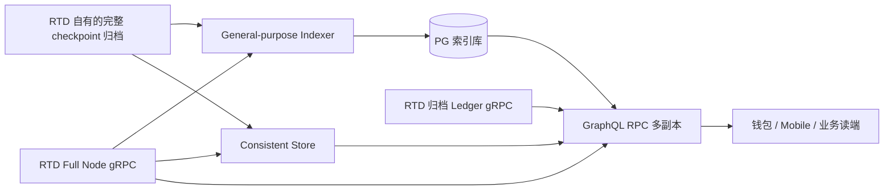

# RTD 通用索引、GraphQL RPC 与 Consistent Store 生产方案

> **RTD 生产约束**：本层只用自建 PostgreSQL、RocksDB 与 MinIO 的开放 S3 协议；历史 Ledger 由自建 HBase 适配后的 `rtd-kv-rpc` 提供。数据库高可用与备份、密钥/证书、网络入口、指标日志告警及镜像仓库也须自建开源。不得把上游 GCS、Google Bigtable、AWS、Azure 或其它闭源云服务写入测试网/正式网必需运行配置。见 [03](./03-远程检查点归档存储与Ledger-gRPC.md)及[开源中间件政策](../../../rtd-archive-service/OPEN_SOURCE_POLICY.md)。

> 调研基线：2026-09-24。Sui 官方生产部署指南是架构和运行方式的依据；命令参数与行为另经本地 `temp/rtd` 源码核对。本文件是**建设与验收方案**，不是已部署、已压测或已恢复验证的记录。文中的 `RTD_*` 均为待填的 RTD 自有资源；绝不能接入 Sui 的公开节点、checkpoint bucket、归档端点或创世快照。

## 1. 结论：官方有标准实现，优先 fork 与运维化

Sui 官方已发布 **General-purpose Indexer + GraphQL RPC + Consistent Store** 的开源实现和[部署指南](https://docs.sui.io/operators/data-management/indexer-stack-setup)，支持自托管。RTD 新链的 `temp/rtd` 已 fork 对应 crates；三者职责不同，均无需从零重写。RTD 的生产可用性仍须完成本方案中的构建、数据与故障验收。

| 标准组件                | RTD 源码与可执行文件                                                                               | 持久层                                                          | 职责                                                                                                                                                 | 明确边界                                                                               |
| ----------------------- | -------------------------------------------------------------------------------------------------- | --------------------------------------------------------------- | ---------------------------------------------------------------------------------------------------------------------------------------------------- | -------------------------------------------------------------------------------------- |
| General-purpose Indexer | `crates/rtd-indexer-alt`、`rtd-indexer-alt-framework`、`rtd-indexer-alt-schema`；`rtd-indexer-alt` | PostgreSQL 兼容库                                               | 消费有序 checkpoint（真实性须由可信来源和独立核验流程确认），按独立管线写入事件、交易、对象版本、epoch、系统包及查询索引；维护每管线水位和可配置修剪 | 不提交或模拟交易；PG 索引表不等于长期原始数据归档                                      |
| GraphQL RPC             | `crates/rtd-indexer-alt-graphql`、`rtd-indexer-alt-reader`；`rtd-indexer-alt-graphql`              | 无本地持久状态；读 PG、Ledger gRPC、Consistent Store、Full Node | 按字段组合筛选/分页/点查；可转发交易执行和模拟；暴露查询限制与健康状态                                                                               | 不是独立数据源；未配完整后端只能提供部分功能；当前本地代码**要求** `--ledger-grpc-url` |
| Consistent Store        | `crates/rtd-indexer-alt-consistent-store`；`rtd-indexer-alt-consistent-store`                      | 每实例独立 RocksDB                                              | 索引最近 checkpoint 的活对象、所有权和余额，按指定 checkpoint 提供一致的 gRPC 读取                                                                   | 不是历史筛选库，不替代 General-purpose Indexer、Ledger 归档或 Full Node                |

上述分工直接来自[官方 GraphQL 架构](https://docs.sui.io/develop/accessing-data/graphql/graphql-rpc)；本地证据见[索引器配置和入口](../../../temp/rtd/crates/rtd-indexer-alt/README.md#L86-L118)、[GraphQL 数据源](../../../temp/rtd/crates/rtd-indexer-alt-graphql/README.md#L10-L38)、[Consistent Store 命令入口](../../../temp/rtd/crates/rtd-indexer-alt-consistent-store/src/args.rs#L24-L83)。若另需按 RTD 业务模型做多年历史或分析索引，可在官方 [`rtd-indexer-alt-framework`](../../../temp/rtd/crates/rtd-indexer-alt-framework/src/cluster.rs) 上加独立 pipeline；[官方 Custom Indexer 文档](https://docs.sui.io/develop/accessing-data/custom-indexer/custom-indexers)明确支持 Rust、Tokio、Diesel/PostgreSQL，以及实现 `Store`/`Connection` 后写入其他存储。**业务自定义索引是增补，不是替换这套标准查询栈的前置条件。**

## 2. 数据面与一致性边界



1. **筛选、分页**：GraphQL 通过 PG 表定位符合条件的交易序号、事件、对象版本，再经 Ledger gRPC 取得详情。索引留 90 天并不意味着 90 天前可按地址筛选；若产品承诺多年搜索，就必须保留对应索引或另建长期查询层。官方建议 PG **30–90 天**作为常规在线窗口，但 `obj_versions` 及若干基础管线当前不可修剪、仍应从创世保留，容量不能只按 90 天估算。[官方管线与容量说明](https://docs.sui.io/operators/data-management/indexer-stack-setup)。RTD 的实际 checkpoint 速率与业务量需要独立测量，**不要照搬 Sui 的 TB 数和 checkpoint/day 换算**。
2. **活状态**：Consistent Store 的四条管线分别处理 `address_balances`、`balances`、`object_by_owner`、`object_by_type`；RocksDB 保留窗口通常按分钟或小时，GraphQL 请求以最近 checkpoint 固定视图。[官方 Consistent Store 说明](https://docs.sui.io/develop/accessing-data/graphql/graphql-rpc)及[本地配置](../../../temp/rtd/examples/prod-config/consistent_store.toml#L1-L10)。它不能回答多年以前任意地址的所有权快照。
3. **点查与执行**：当前 `rtd-indexer-alt-graphql` 在启动时就检查 Ledger gRPC reader，缺失则报 `--ledger-grpc-url must be configured`；交易执行/模拟另需 Full Node，未配则相关 resolver 不可用。[本地启动检查](../../../temp/rtd/crates/rtd-indexer-alt-graphql/src/lib.rs#L342-L373)。`rtd-indexer-alt-graphql/README.md` 中省略 Ledger URL 的“最小启动命令”已与该运行时代码冲突，不能当作生产命令。[Sui 1.79.1 发布说明](https://github.com/MystenLabs/sui/releases/tag/mainnet-v1.79.1)也已要求 GraphQL 的 `--ledger-grpc-url`，并移除 PG KV 回退。
4. **跨源一致性**：Indexer 的每管线 `watermarks` 记录高、低可读界，GraphQL 为每次请求取水位快照，再将查询限制到共同可用范围；Consistent Store 自有水位，与 PG 的水位独立。[GraphQL 水位任务](../../../temp/rtd/crates/rtd-indexer-alt-graphql/src/task/watermark.rs#L38-L103)。这是按 checkpoint 对齐的读语义，**不是 PG、RocksDB、HBase 之间存在分布式原子事务**。调用方应固定 checkpoint 或使用 `serviceConfig.availableRange`，并理解链头与索引水位之间会有可见延迟。
5. **链身份**：索引管线从 checkpoint 得到 chain ID，和 `watermarks.chain_id` 对比，发现不一致会永久失败而非静默混链。[链身份校验](../../../temp/rtd/crates/rtd-indexer-alt-framework/src/pipeline/processor.rs#L116-L134)、[水位 schema](../../../temp/rtd/crates/rtd-indexer-alt-schema/src/schema.rs#L214-L225)。RTD 仍应为每个网络使用独立 PG、RocksDB、归档 namespace，并在上线验证中比较 genesis digest、Full Node、Ledger、GraphQL 四端链身份；不能靠品牌名或 URL 判断。

## 3. General-purpose Indexer：建库、回填、稳态

### 3.1 源码与构建

在经过品牌、依赖和协议一致性验收的 `temp/rtd` 提交上构建三个二进制，固定其 Git SHA、Cargo.lock、镜像摘要和对应 `rtd-apis` proto 版本。建议 CI 先运行相关单元与 E2E 套件；有 PG 的 E2E 才能覆盖迁移和查询行为。源码 README 列出了 `rtd-indexer-alt`、`rtd-indexer-alt-framework`、`rtd-indexer-alt-e2e-tests` 的测试入口，[详见本地说明](../../../temp/rtd/crates/rtd-indexer-alt/README.md#L62-L84)。构建示例：

```bash
cd /Users/changzechuan/WenchuanProjects/RTD-Blockchain/temp/rtd
cargo build --locked --release --bin rtd-indexer-alt --bin rtd-indexer-alt-graphql --bin rtd-indexer-alt-consistent-store
```

这只是源码验证过名称的**待执行命令**；没有把构建成功或镜像可部署当作本报告已验证事实。

### 3.2 PostgreSQL 与管线分组

1. 建立 RTD 网络专属 PG 数据库、独立写入用户和只读 GraphQL 用户；开启 TLS、PITR/WAL 归档、定期备份和恢复演练。索引器可自动执行 schema migrations，但生产上线应在影子库先跑迁移、审查锁表与回滚方案。迁移目录为 [`rtd-indexer-alt-schema/migrations`](../../../temp/rtd/crates/rtd-indexer-alt-schema/migrations)，自动执行代码见[本地 `setup_indexer`](../../../temp/rtd/crates/rtd-indexer-alt/src/lib.rs#L102-L111)。
2. 基于 [`examples/prod-config/indexer/`](../../../temp/rtd/examples/prod-config/indexer) 创建按速度/保留策略分组的 TOML。官方[运营指南](https://docs.sui.io/operators/data-management/indexer-stack-setup)建议 `events.toml`、`tx_affected_addresses.toml`、`tx_affected_objects.toml`、`tx_calls.toml`、`tx_kinds.toml` 为可修剪组，`obj_versions.toml` 与 `unpruned.toml` 从 genesis 开始且完整保留。尤其 [`unpruned.toml`](../../../temp/rtd/examples/prod-config/indexer/unpruned.toml#L1-L20) 中的 `cp_sequence_numbers` 是按 checkpoint 做交易范围映射及部分 pruner 的前提；不得因为名字像元数据而删除。
3. `retention` 的单位是 **checkpoint 数量**，不是天数。本地 `events.toml` 的 `31104000` 是 Sui 官方 90 天示例数，[见配置](../../../temp/rtd/examples/prod-config/indexer/events.toml#L1-L6)；RTD 应由实测 checkpoint 产生速率、产品查询承诺、恢复时间目标重新计算，再做容量压测。绝不可先开 pruner 再决定是否需要长期筛选数据。
4. 每个 TOML 用一个索引进程，可对不同管线组水平拆分；每个进程使用唯一 metrics 监听地址。**不要假设同一管线多活写同一 DB 自动实现 leader election**：标准配置按“不同管线分组并行”部署；同一管线的高可用建议由编排层做单活故障接管，接管实例复用 PG 已提交 watermark，从 RTD 自有 checkpoint 源追赶。要做同一管线并行多写，先验证框架版本的冲突、watermark 与事务语义。

### 3.3 完整历史回填

RTD 的 `--remote-store-s3`、`--remote-store-gcs`、`--remote-store-azure`、`--remote-store-url`、`--local-ingestion-path`、`--rpc-api-url` 是互斥 checkpoint 源；`--streaming-url` 是额外的低延迟订阅，[本地参数定义](../../../temp/rtd/crates/rtd-indexer-alt-framework/src/ingestion/ingestion_client.rs#L69-L102)、[streaming 参数](../../../temp/rtd/crates/rtd-indexer-alt-framework/src/ingestion/streaming_client.rs#L49-L54)。官方建议回填读**完整保留的可靠 checkpoint 对象存储**，追平后切 Full Node gRPC polling + streaming；公网 `checkpoints.mainnet.sui.io` 和公开 fullnode 服务仅供测试，[官方手册](https://docs.sui.io/operators/data-management/indexer-stack-setup)。RTD 自建 S3/MinIO 应先证明从 checkpoint 0 至目标 tip 的连续覆盖和认证，且其协议格式能被此 fork 的摄取客户端读取。

以下命令假设 `RTD_CHECKPOINT_BUCKET` 是本链专属 bucket，自建 MinIO endpoint 与凭据已由服务账号环境安全注入（当前 dev 的单机 MinIO 仅验证 S3 合同）；具体 `--remote-store-s3` 传值需用**本次构建二进制的 `--help` 与一段真实 RTD checkpoint**校验：

```bash
rtd-indexer-alt indexer \
  --config /etc/rtd/indexer/unpruned.toml \
  --database-url "$RTD_INDEXER_DATABASE_URL" \
  --remote-store-s3 "$RTD_CHECKPOINT_BUCKET" \
  --metrics-address 127.0.0.1:9184
```

`obj_versions.toml` 同样从 checkpoint 0 启动；可修剪组可选择经验证的 `--first-checkpoint`，但如果已经有 watermark，源码会忽略此参数而从已提交 watermark 继续。[本地参数语义](../../../temp/rtd/crates/rtd-indexer-alt-framework/src/lib.rs#L55-L75)、[官方回填与重新索引说明](https://docs.sui.io/operators/data-management/indexer-stack-setup)。**不能把 `--first-checkpoint` 用在 `obj_versions` 或 Consistent Store 空库上跳过创世**，否则对象版本/余额所有权依赖会缺失。

回填切换到稳态时，先停对应进程，保留库和 watermark；确认 Full Node `LedgerService` 仍保留接续位置，再以同一个 TOML 和 DB URL 启动：

```bash
rtd-indexer-alt indexer \
  --config /etc/rtd/indexer/unpruned.toml \
  --database-url "$RTD_INDEXER_DATABASE_URL" \
  --rpc-api-url "$RTD_FULLNODE_GRPC_URL" \
  --streaming-url "$RTD_FULLNODE_GRPC_URL" \
  --metrics-address 127.0.0.1:9184
```

流只覆盖新 checkpoint，历史缺口要由 polling 或完整归档补；持续落后超出 Full Node 修剪窗口时，应停接管进程并从 RTD 自有完整归档补齐，不能重启后直接“追最新”跳过区间。[官方数据源与流语义](https://docs.sui.io/develop/accessing-data/custom-indexer/custom-indexers)。

### 3.4 水位、修剪与重建

读侧最低共同水位由所有必要管线决定。至少监控 `sourceHead`、每条 `checkpoint_hi_inclusive`、`reader_lo`、`pruner_hi`、源摄取滞后、PG 写入延迟与链身份；本地 schema 字段见[watermarks 定义](../../../temp/rtd/crates/rtd-indexer-alt-schema/src/schema.rs#L214-L225)。官方给出只读排障查询：

```sql
SELECT pipeline, checkpoint_hi_inclusive, reader_lo, pruner_hi,
       encode(chain_id, 'hex') AS chain_id_hex
FROM watermarks
ORDER BY pipeline;
```

该 SQL 用来审计进度，不证明数据内容完整。每个目标区间还需抽样比较 RTD Full Node/认证 checkpoint/归档 Ledger 的交易 digest、对象版本、事件数量与 checkpoint digest。本版 GraphQL 健康路径是 `/graphql/health`，它只探测 PG TCP 连通和汇总 watermark 时间滞后，不主动测试 Ledger、Consistent Store、Full Node 或数据真实性；还需对各后端做真实合成查询。[路由](../../../temp/rtd/crates/rtd-indexer-alt-graphql/src/lib.rs#L87-L89)、[健康实现](../../../temp/rtd/crates/rtd-indexer-alt-graphql/src/health.rs#L50-L124)。

重建单条管线时，必须将其目标数据表与对应 watermark 作为一个变更单元处理；仅删 watermark 会让新旧行混合。优先做**隔离新库或影子表重建、追平、比对、切流**，在线修复才采用经审查的停写事务操作。官方明确 `--first-checkpoint` 不会覆盖已存在 watermark，并给出了表与 watermark 一起清理的范式；见[官方故障与重建步骤](https://docs.sui.io/operators/data-management/indexer-stack-setup)。这些步骤可能销毁历史索引，正式环境需先确保可从 RTD 完整 checkpoint 归档回放且已有可恢复的 PG 备份。

## 4. Consistent Store：近实时活状态的独立服务

Consistent Store 是**Indexer + gRPC 同进程**，使用本地持久 SSD 上的 RocksDB，与 PG 索引器分别追 checkpoint、分别维护水位。[官方架构与部署](https://docs.sui.io/operators/data-management/indexer-stack-setup)及[本地 Run/Restore 命令](../../../temp/rtd/crates/rtd-indexer-alt-consistent-store/src/args.rs#L24-L83)。它回答的主要是某 checkpoint 的地址余额、owner 持有对象和类型筛选；GraphQL 若缺少它，钱包的活余额/拥有对象查询可能不可用或能力受限。四条管线必须覆盖同一个 RTD 网络，并且空库从 genesis 回放；不能仅从“最近 1 小时”起步，因为当前持有状态依赖先前对象变更。

**生产首次启动有两个合法路径：**

1. 若 RTD 自己已经生成并验证与本链 genesis 和版本兼容的 formal snapshot，按 `restore` 命令将所需四条管线恢复到空的 RocksDB 路径，然后从 RTD 自有连续 checkpoint 源追赶至 Full Node 保留窗内，最后用 gRPC steady state。
2. 若 RTD 没有 formal snapshot，则在**空路径从 genesis** 消费 RTD 自有完整 checkpoint 归档。Sui 的官方 formal snapshot URL 不属于 RTD，不能混用。正式上线应尽早建设 RTD 自有可信快照生成、保存、验证和恢复演练，降低新副本重建时间。

以已完成 RTD 自有快照恢复或 genesis 回放的专属 RocksDB 路径为前提，稳态命令形态如下：

```bash
rtd-indexer-alt-consistent-store run \
  --database-path "$RTD_CONSISTENT_ROCKSDB_PATH" \
  --rpc-api-url "$RTD_FULLNODE_GRPC_URL" \
  --streaming-url "$RTD_FULLNODE_GRPC_URL" \
  --rpc-listen-address 127.0.0.1:7001 \
  --metrics-address 127.0.0.1:9186 \
  --config /etc/rtd/consistent-store.toml
```

本地 `Run` 确实接收这些参数，[入口](../../../temp/rtd/crates/rtd-indexer-alt-consistent-store/src/args.rs#L24-L50)。HA 建议两个或更多**独立的** Consistent Store 副本，各自 RocksDB 路径、各自同步与恢复；内部负载均衡器只选水位已追平、四条管线齐全、gRPC health 为 `SERVING` 的副本。**同一 RocksDB 路径只由一个进程打开**，不要通过共享卷做多进程读写。副本落后 Full Node 保留窗口时要先从 RTD 完整 checkpoint 归档补追，不能跳过对象变更继续服务。备份 RocksDB 需使用已验证的在线快照方法，或停服务后做一致文件拷贝；不能把单个目录的部分文件视作可恢复备份。[官方恢复与 HA 注意事项](https://docs.sui.io/operators/data-management/indexer-stack-setup)。

## 5. GraphQL RPC：聚合入口与可用性门禁

GraphQL 是**无状态、可多副本**的服务；内部至少连接：PG、归档或覆盖充足的 Ledger gRPC、Consistent Store、Full Node gRPC。[官方组件说明](https://docs.sui.io/develop/accessing-data/graphql/graphql-rpc)及[本地参数定义](../../../temp/rtd/crates/rtd-indexer-alt-graphql/src/args.rs#L35-L76)。生产命令示例：

```bash
rtd-indexer-alt-graphql rpc \
  --config /etc/rtd/graphql.toml \
  --indexer-config /etc/rtd/indexer/unpruned.toml \
  --indexer-config /etc/rtd/indexer/obj_versions.toml \
  --indexer-config /etc/rtd/indexer/events.toml \
  --indexer-config /etc/rtd/indexer/tx_affected_addresses.toml \
  --indexer-config /etc/rtd/indexer/tx_affected_objects.toml \
  --indexer-config /etc/rtd/indexer/tx_calls.toml \
  --indexer-config /etc/rtd/indexer/tx_kinds.toml \
  --database-url "$RTD_GRAPHQL_DATABASE_URL" \
  --ledger-grpc-url "$RTD_LEDGER_GRPC_URL" \
  --consistent-store-url "$RTD_CONSISTENT_GRPC_URL" \
  --fullnode-rpc-url "$RTD_FULLNODE_GRPC_URL" \
  --rpc-listen-address 127.0.0.1:7000 \
  --metrics-address 127.0.0.1:9185
```

`--indexer-config` 可重复，服务用它识别 PG 中实际应存在的管线并观察水位，[本地代码](../../../temp/rtd/crates/rtd-indexer-alt-graphql/src/main.rs#L76-L89)。不能列了管线配置但没真正运行相应索引器；也不能在不同 GraphQL 副本上给不同的管线清单却混在同一个公开入口。`--ledger-grpc-url` 应指向**本链** LedgerService，正式历史服务宜用独立归档；若暂指 Full Node，旧对象/交易会随修剪而不可见。`--fullnode-rpc-url` 仅执行/模拟，不让索引器替代它。[本地 GraphQL 强制 Ledger 与可选 Full Node](../../../temp/rtd/crates/rtd-indexer-alt-graphql/src/lib.rs#L342-L373)。

在对外网关前至少加 TLS、身份与配额、请求体大小、GraphQL depth/nodes/输出规模限制、超时、CORS 白名单、按 API 类别限流，以及针对高成本查询的审计。内网 gRPC 服务同样限制来源和凭据；别将 PG、RocksDB 或归档管理口直接暴露公网。RTD 的 `graphql.toml` 应从当前二进制 `generate-config` 生成后逐项审查。上游[示例限额与 health](https://docs.sui.io/operators/data-management/indexer-stack-setup)为模板，本地配置类型支持查询深度、节点数、输出节点、请求时限、`max-checkpoint-lag-ms` 等，[源码](../../../temp/rtd/crates/rtd-indexer-alt-graphql/src/config.rs#L26-L105)。上游示例里若含 SuiNS 包地址、zkLogin 环境或 Sui 特定内容，须替换成 RTD 自己已部署且验证的值或停用对应字段，不能全量复制。

公开路由的 readiness 条件应至少满足：`/graphql/health` 正常，并另行实测各后端；所有生产必要管线水位追近链头、同链身份、Ledger 覆盖 GraphQL 需求的最低与最高 checkpoint、Consistent Store 四条管线水位符合活查询 SLO、Full Node 执行/模拟可用。若允许只读降级，应以不同 endpoint/明确功能声明承载，避免钱包误以为“GraphQL 200 = 交易可提交”。

## 6. 生产高可用、恢复与发布次序

| 故障域           | 推荐建设                                                                    | 恢复及验证重点                                                                                     |
| ---------------- | --------------------------------------------------------------------------- | -------------------------------------------------------------------------------------------------- |
| Checkpoint 源    | RTD 自有、从 genesis 连续、认证且不可篡改的对象存储；跨区副本和生命周期锁定 | 在节点修剪前校验每段已归档；断源时暂停水位，不能跳号。源完整性和归档 Ledger 建设另见本目录归档文档 |
| PG               | 主库 + 同步/异步副本按 RPO 选择，WAL/PITR，定期离线恢复                     | Indexer 仅写当前主库；GraphQL 读副本须设复制延迟门禁，以免其水位与主库不一致；迁移先影子环境验证   |
| Indexer          | 不同管线组并行；每条生产管线单活 writer + 可接管 standby；持久 watermark    | 故障接管从已提交 watermark + 1 回放，必须确认可用源未过修剪界；无凭据的 Sui 公网服务不得作备用源   |
| Consistent Store | 至少两份独立 RocksDB，独立快照/恢复并各自追链                               | 摘掉落后副本；空库从 genesis 或 RTD formal snapshot 恢复，不能从任意近期高度补起                   |
| GraphQL          | 多无状态副本跨可用区；内部后端健康路由与公网网关                            | 只切到链身份、管线清单、可用区间与执行能力相同的副本；保留错误、延迟、查询成本与限流指标           |

推荐上线顺序：**认证并保全 RTD checkpoint 归档 → 配好 PG/备份 → 回填不可修剪管线 → 回填并追平 30/90 天查询管线 → 建立两份 Consistent Store → 验证归档 Ledger 的近/旧点查 → 上 GraphQL 内网端点 → 水位/身份/业务查询验收 → 经网关灰度前端流量**。官方明确要求不可修剪管线追平后再启动 GraphQL，并建议回填与 steady state 分阶段，[官方部署指南](https://docs.sui.io/operators/data-management/indexer-stack-setup)。

### 最低发布验收矩阵

| 检查     | 必须取得的实证                                                                                                                                                                            |
| -------- | ----------------------------------------------------------------------------------------------------------------------------------------------------------------------------------------- |
| 同链     | 本次 genesis digest 与 Full Node `GetServiceInfo`、PG `watermarks.chain_id`、Ledger gRPC、GraphQL `chainIdentifier` 一致；测试错链接入应拒绝                                              |
| 连续摄取 | checkpoint 0 到链头无缺口；随机及边界 checkpoint 对照认证摘要、交易/事件数、对象版本；所有生产管线水位不倒退                                                                              |
| 历史查询 | 新旧边界两侧交易 digest、对象 ID+version、checkpoint 点查一致；本 GraphQL 地址/事件筛选只承诺 PG 实际覆盖区间；归档 Ledger `List*` 是另一路径，须单独启用、验收与接入；越界明确报可用范围 |
| 活状态   | Consistent Store 四条管线齐全，指定同一 checkpoint 的 owner/余额查询跨副本一致；落后副本自动摘流                                                                                          |
| 交易     | GraphQL 模拟与执行确实经 RTD Full Node；签名后的 digest、effects 和最终 checkpoint 与 Full Node 一致；断 Full Node 时不得报成成功                                                         |
| 故障恢复 | Indexer 停机跨越 Full Node 热窗口后可从 RTD 完整 checkpoint 归档补齐；PG PITR 恢复、Consistent Store 重建、GraphQL 多副本故障切换均有演练记录                                             |
| 安全     | 生产凭据仅服务端持有；归档/PG/RocksDB 不公开；网关限流、GraphQL 查询复杂度、备份加密、访问审计通过安全审查                                                                                |

以上门禁是 RTD 上线**建议验收标准**，不是本次只读调研已完成的测试。监控中单独区分“服务存活”“链头可执行”“可查询最近”“可查询某个旧区间”；绝不可用单一 HTTP 200 覆盖全部数据完整性主张。

## 7. 官方资料与本地实现对照

- [Sui：GraphQL and General-Purpose Indexer 生产部署](https://docs.sui.io/operators/data-management/indexer-stack-setup)：管线分组、回填/稳态命令、Consistent Store restore、GraphQL、PG 规模与水位排障。其公网端点和资源数量只适用于 Sui，应改为 RTD 自建与实测。
- [Sui：GraphQL RPC 架构](https://docs.sui.io/develop/accessing-data/graphql/graphql-rpc)：五组件分工、查询限额、PG 管线分类及 RocksDB Consistent Store。
- [Sui：Custom Indexer 框架](https://docs.sui.io/develop/accessing-data/custom-indexer/custom-indexers)、[构建教程](https://docs.sui.io/develop/accessing-data/custom-indexer/build)：checkpoint 摄取、Rust/Tokio/Diesel 管线与可插拔存储。
- [Sui `mainnet-v1.79.1` 发布说明](https://github.com/MystenLabs/sui/releases/tag/mainnet-v1.79.1)：GraphQL 的 Ledger gRPC URL 必填、不再从 PG 做 KV 点查回退。
- 本地 fork：[`rtd-indexer-alt`](../../../temp/rtd/crates/rtd-indexer-alt/README.md)、[`rtd-indexer-alt-graphql`](../../../temp/rtd/crates/rtd-indexer-alt-graphql/README.md)、[`rtd-indexer-alt-consistent-store` 命令](../../../temp/rtd/crates/rtd-indexer-alt-consistent-store/src/args.rs)、[正式示例配置](../../../temp/rtd/examples/prod-config/indexer)。本文所有 RTD 运行命令均以这些本地入口和参数为基线，最终仍需对**实际构建的同一版本**执行 `--help`、集成测试和端到端验收。
